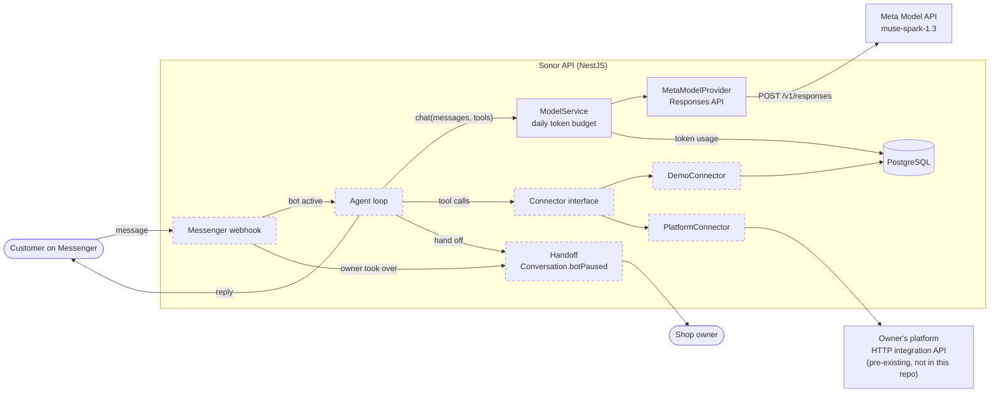

# Sonor

A Mongolian-language AI sales agent for small businesses on Facebook Messenger, built on Muse Spark through the Meta Model API.

**Demo video:** TODO: add the demo video link.

> **Status, 2 Nov 2026.** Implemented and tested: the multi-tenant data model, two fictional demo shops, and the Muse Spark model layer (tool calling, encrypted reasoning replay, retries, per-tenant daily token budget). **Planned**, not in the repository yet: the agent loop, the Messenger webhook, the data connectors, owner handoff and the evaluation suite. Each section below says which parts exist.

## The problem

In Mongolia, small businesses sell mostly through their Facebook Page, and most sales conversations happen in Messenger. Owners answer the same questions about price, availability and payment by hand, often late at night after the shop has closed. Customers write in Mongolian Cyrillic or in informal Latin transliteration, often mixing the two, so keyword bots and canned replies miss many messages.

## What Sonor does

The agent loop isn't built yet, so this is the planned path of one conversation with the fictional demo shop Салхин Дээл. Each step notes what exists today.

1. A customer writes to the shop's Page in Latin script: `nooluuran malgai baigaa yu? hed ve?` ("Do you have the cashmere hat? How much is it?").
   _Planned: the Messenger webhook. The `Message` table exists, with a unique key on the Messenger message ID so redelivered webhooks are ignored._
2. Sonor finds the shop by its Page ID and checks whether the owner has taken over the conversation. If so, the agent stays silent.
   _Planned: the check. The `Tenant.facebookPageId` and `Conversation.botPaused` fields exist._
3. The agent sends the conversation and its tools to Muse Spark through `ModelService.chat`.
   _Implemented and tested (model layer)._
4. Muse Spark calls a catalog tool. The `DemoConnector` matches the Latin-script query to the Cyrillic product "Ноолууран малгай": 59,000₮, 15 in stock.
   _Planned: the connector and the search. The product is in the seeded demo catalog._
5. The agent replies in Mongolian with the price and availability.
   _Planned._
6. If the customer wants to buy, the agent drafts an order with prices read from the database and sends a payment link.
   _Planned. The `Order`, `OrderItem` and `PaymentLink` tables exist._

TODO: replace this list with a real transcript from `/dev/chat` or Messenger once the agent runs end to end.

What you can run today is the model side of this loop: `pnpm model:smoke` sends a Mongolian message to Muse Spark, has it call a dummy tool, returns a fake tool result and checks the final answer. See [Evaluation](#evaluation).

## How Sonor uses Meta models

| Model                             | What it does in Sonor                                                                                 | Status                                                  |
| --------------------------------- | ----------------------------------------------------------------------------------------------------- | ------------------------------------------------------- |
| Muse Spark 1.3 (`muse-spark-1.3`) | The agent's model: reads the conversation, decides which tools to call, writes the reply in Mongolian | Model layer implemented and tested. Agent loop planned. |

Sonor uses no other Meta models. TODO: add a row here if you add one before submission.

How Sonor calls Muse Spark (`apps/api/src/model/meta`):

- **Endpoint.** The Responses API, `POST https://api.meta.ai/v1/responses`, with a bearer API key.
- **Stateless.** Every request sets `store: false` and sends the full history. Requests ask for `reasoning.encrypted_content`, and Sonor sends those encrypted reasoning items back on the next turn (through `providerState`), so the model keeps its reasoning across tool calls without Meta storing the conversation.
- **Tools.** Tools are sent as function tools with `strict: false`. The API doesn't guarantee that tool arguments match the schema, so `ToolCall.arguments` is the parsed JSON object or `null`, never trusted as-is.
- **Messages.** The system prompt goes in the `developer` role. Text the model writes right before a tool call is tagged `commentary` and kept out of the reply.
- **Output limits.** `max_output_tokens` includes reasoning tokens. A response cut off by the limit is reported as `finishReason: 'length'`, and a half-written tool call is dropped.
- **Images.** The request mapping supports `input_image` items. No feature sends images yet.

Agent code depends only on `model.types.ts`. `MODEL_PROVIDER` and `MODEL_ID` select the implementation; `meta` is the only provider.

## Architecture

Solid boxes are implemented. Dashed boxes are planned.



| Path                      | Contents                                                       |
| ------------------------- | -------------------------------------------------------------- |
| `apps/api/src/model`      | Provider-neutral model interface, `ModelService`, token budget |
| `apps/api/src/model/meta` | Muse Spark provider and Responses API mapping                  |
| `apps/api/src/common`     | AES-256-GCM helper for secrets at rest                         |
| `apps/api/prisma`         | Schema, migrations, seed and fictional demo data               |
| `apps/api/scripts`        | `model-smoke.ts`, the live model check                         |

### Tool loop

Implemented: `ModelService.chat(messages, tools, { tenantId })` returns the reply text, tool calls, finish reason, token usage and `providerState`. The caller appends `toAssistantMessage(result)` to the history (this carries the encrypted reasoning), runs each tool, appends one `tool` message per call, and calls the model again until it answers with text. `pnpm model:smoke` runs this loop once against the live API.

Planned: the agent that runs this loop with the business tools (catalog lookup, order drafts, payment links). Because the API doesn't validate tool arguments or truncate context, the agent has to validate every tool call's arguments and manage the history length itself.

### Tenant isolation

Each business is a `Tenant`, and every other table carries a `tenantId` with a cascading foreign key. Natural keys include it: customers are unique per `(tenantId, psid)`, messages per `(tenantId, externalId)`, token usage per `(tenantId, day)`. Each tenant has one Facebook Page (`facebookPageId` is unique), which is how webhook events will be routed to a tenant. Page access tokens and platform API keys are stored only as AES-256-GCM ciphertext (`src/common/encryption.ts`, key from `ENCRYPTION_KEY`). Every query is scoped by tenant; today the only runtime query is the token budget, which is.

### Cross-script Mongolian search

Planned. Customers type Mongolian in Cyrillic or in informal Latin transliteration, while catalogs are in Cyrillic. The demo catalog is Cyrillic-only so it can exercise this.

TODO: describe the matching approach once it's implemented.

### Grounding check

Planned. Already in the data model: order prices come from the database, never from model output. `OrderItem.unitPrice` is a server-side snapshot taken when the order is drafted, and `Order.total` is computed from those snapshots.

TODO: describe what the grounding check verifies and what happens when a check fails.

### Stock policy

Planned. The demo catalogs include out-of-stock items, items with only 2 left, and one inactive product, so the policy can be tested.

TODO: describe the policy: what the agent says about low or zero stock, and whether it takes orders for items that are out of stock.

### Cost and token limits

Implemented and tested:

- **Daily budget.** `DAILY_TOKEN_LIMIT` tokens per tenant per UTC day. Usage is stored in the `TokenUsage` table, so a restart doesn't reset it. The budget is checked before each call and usage is recorded after it, so concurrent calls can overshoot the limit by at most one call each. Once the limit is reached, new calls are refused.
- **Output cap.** `MODEL_MAX_OUTPUT_TOKENS` caps every call, reasoning included. A per-call option can lower it but never raise it.
- **Timeouts and retries.** `MODEL_TIMEOUT_MS` per HTTP attempt. Up to `MODEL_MAX_RETRIES` retries, only for 429 and 5xx (except 504), with exponential backoff, jitter and `Retry-After`. If `Retry-After` asks for more than 10 seconds, the call fails instead of stalling the chat.
- **Reasoning effort.** `MODEL_REASONING_EFFORT` sets how much the model reasons per call; higher costs more.
- **Logging.** Logs record token counts (input, cached, output, reasoning), finish reason, tool names and timing. They never contain prompts, replies or the API key, and a test checks that the key stays out of errors and retry logs.

## What was built during the Meta Global AI Developer Hackathon (Oct 26 – Nov 4, 2026)

**Everything in this repository was written during the hackathon.** The first commit is `5fb954f` on 2026-11-02 at 12:11 (UTC+8). The latest commit when this README was written is the one that adds it, on 2026-11-02. You can check with `git log --reverse --date=iso`.

TODO: update the latest commit date before submission.

**Pre-existing, not in this repository:** the author's private multi-tenant platform and its website chatbot. None of their code is here. Sonor's `PlatformConnector` (planned) will reach the platform only through its HTTP integration API.

The integration point, as far as it exists today:

- A tenant with `connectorType = PLATFORM` reads business data from the platform API instead of the local `Product` table.
- The `Tenant` table has `platformBaseUrl` and `platformApiKeyEncrypted` (AES-256-GCM) for that connection.

TODO: document the endpoints Sonor calls (paths, request and response fields, authentication), without internal details.

TODO: confirm whether the platform base URL and API key come from environment variables or from the per-tenant fields above, and update this list.

Timeline (from `git log`, times UTC+8):

| When           | Work                                                                                                                                            |
| -------------- | ----------------------------------------------------------------------------------------------------------------------------------------------- |
| Oct 26 – Nov 1 | TODO: add work done outside this repository.                                                                                                    |
| Nov 2, 12:11   | Repository setup: pnpm workspace, ESLint and Prettier, NestJS app with `/health`, Docker Compose Postgres, first README                         |
| Nov 2, 12:31   | Prisma 7 with PostgreSQL, data model and first migration, AES-256-GCM helper for secrets, seed with two fictional shops                         |
| Nov 2, 13:26   | Model layer: provider-neutral interface, Muse Spark provider on the Responses API, per-tenant daily token limit, unit tests, `pnpm model:smoke` |
| Nov 2          | This README                                                                                                                                     |
| TODO           | Add later work (agent loop, webhook, connectors, evaluation) as it lands, and any work done outside this repository.                            |

## Evaluation

`pnpm agent:eval` is **planned** and not in the repository yet.

TODO: describe how to run `pnpm agent:eval` and what it checks, and add its latest results table.

What runs today:

- `pnpm test`: unit tests (Vitest). No network or database needed.
- `pnpm --filter @sonor/api test:e2e`: boots the app and calls `GET /health`. Needs `DATABASE_URL` set, but not a running database.
- `pnpm model:smoke`: live check against the Meta Model API (needs `MODEL_API_KEY`, costs a few thousand tokens). It sends a short Mongolian message, then a message with a dummy `get_weather` tool, checks that the tool call parses, returns a fake result and checks the final answer. This also exercises encrypted reasoning replay.

Latest results, run on 2026-11-02 at commit `dcf6735`:

| Suite                      | File                                           | Passed | What it checks                                                                                                                                                                                                              |
| -------------------------- | ---------------------------------------------- | ------ | --------------------------------------------------------------------------------------------------------------------------------------------------------------------------------------------------------------------------- |
| Responses API mapping      | `src/model/meta/meta-responses.mapper.spec.ts` | 10/10  | Stateless requests with encrypted reasoning, function tools, every message role, reasoning replay, tool-call parsing including malformed arguments, commentary kept out of replies, output-limit cut-offs, failed responses |
| Muse Spark provider (HTTP) | `src/model/meta/meta-model.provider.spec.ts`   | 13/13  | Bearer auth to `/v1/responses`, output cap, retries on 429 and 5xx with backoff and `Retry-After`, no retries on 400/401/402/504, timeouts, missing key, API key kept out of errors and logs                                |
| Model service              | `src/model/model.service.spec.ts`              | 4/4    | Usage recorded per tenant, calls refused at the daily limit, logs counts but not prompts or replies, failures logged without recording usage                                                                                |
| Model config               | `src/model/model.config.spec.ts`               | 8/8    | Defaults to Muse Spark 1.3, env overrides, rejects invalid values                                                                                                                                                           |
| Encryption                 | `src/common/encryption.spec.ts`                | 8/8    | Round trips (including Mongolian text), fresh IV per call, wrong key, tampered and malformed payloads, key parsing                                                                                                          |
| Health                     | `src/health/health.controller.spec.ts`         | 1/1    | `/health` reports ok                                                                                                                                                                                                        |
| Health, end to end         | `test/app.e2e-spec.ts`                         | 1/1    | `GET /health` on the running app                                                                                                                                                                                            |

## Running it locally

### Prerequisites

- Node.js 22.18+ or 24.11+
- pnpm 11
- Docker, for the local Postgres
- A Meta Model API key, for anything that calls the model

### Setup

1. Install dependencies. This also generates the Prisma client.

   ```bash
   pnpm install
   ```

2. Create your `.env` from the example. Set `ENCRYPTION_KEY` to the output of `openssl rand -base64 32`. To call the model, also set `MODEL_API_KEY`.

   ```bash
   cp .env.example .env
   ```

3. Start Postgres (on localhost:5433 by default), apply migrations and load the demo data.

   ```bash
   pnpm db:up
   ```

   ```bash
   pnpm db:migrate
   ```

   ```bash
   pnpm db:seed
   ```

4. Run the API on http://localhost:3000.

   ```bash
   pnpm dev
   ```

5. Check it's up.

   ```bash
   curl http://localhost:3000/health
   ```

### Environment variables

All of them are listed in `.env.example`. Never commit `.env`.

| Variable                                            | Description                                                                        |
| --------------------------------------------------- | ---------------------------------------------------------------------------------- |
| `NODE_ENV`                                          | Node environment                                                                   |
| `PORT`                                              | HTTP port for the API                                                              |
| `POSTGRES_USER`, `POSTGRES_PASSWORD`, `POSTGRES_DB` | User, password and database name for the local Postgres container                  |
| `POSTGRES_PORT`                                     | Host port for the local Postgres container                                         |
| `DATABASE_URL`                                      | Postgres connection string used by Prisma                                          |
| `ENCRYPTION_KEY`                                    | 32 random bytes, base64. Encrypts Page access tokens and platform API keys at rest |
| `MODEL_PROVIDER`                                    | Model provider implementation (only `meta` exists)                                 |
| `MODEL_ID`                                          | Model name sent to the API                                                         |
| `MODEL_BASE_URL`                                    | Base URL of the Meta Model API                                                     |
| `MODEL_API_KEY`                                     | Meta Model API key. Optional at boot; model calls fail until it's set              |
| `MODEL_TIMEOUT_MS`                                  | Timeout per HTTP attempt, in milliseconds                                          |
| `MODEL_MAX_RETRIES`                                 | Retries for 429 and 5xx responses                                                  |
| `MODEL_MAX_OUTPUT_TOKENS`                           | Output token cap per call, reasoning tokens included                               |
| `MODEL_REASONING_EFFORT`                            | `minimal`, `low`, `medium`, `high`, `xhigh` or `max`                               |
| `DAILY_TOKEN_LIMIT`                                 | Model tokens per tenant per UTC day                                                |

TODO: add the Messenger webhook variables when the webhook lands.

### Migrate and seed

- `pnpm db:migrate` applies the migrations. After a schema change, `pnpm db:migrate --name <change>` creates a new one.
- `pnpm db:seed` loads two fictional shops with placeholder Page IDs and no real tokens:
  - **Салхин Дээл**: deel and winter wear, 12 products with sizes and colors
  - **Шүүдэр Гоо**: cosmetics, 11 products
- `pnpm db:reset` drops the local database, re-applies the migrations and re-seeds.

Re-running the seed replaces each shop's catalog. It never overwrites a Page ID or token already set on a tenant.

### Chat with the agent locally: `/dev/chat` (planned)

Planned: a local endpoint for talking to the agent without Messenger. It isn't in the repository yet.

TODO: document the request and response format once `/dev/chat` exists.

### Connect a Messenger Page (planned)

Planned: the webhook isn't built yet, so a Page can't be connected. Each tenant already stores a `facebookPageId` and an encrypted Page access token; the seed uses placeholders for both.

TODO: add the steps: Meta app setup, webhook URL and verify token, Page subscription, and storing the Page access token for a tenant.

### Scripts

| Command                        | What it does                                                           |
| ------------------------------ | ---------------------------------------------------------------------- |
| `pnpm dev`                     | Run the API in watch mode                                              |
| `pnpm build` / `pnpm start`    | Build, then run the compiled API                                       |
| `pnpm test`                    | Unit tests (Vitest)                                                    |
| `pnpm lint`                    | ESLint                                                                 |
| `pnpm format` / `format:check` | Prettier                                                               |
| `pnpm db:up` / `pnpm db:down`  | Start / stop local Postgres                                            |
| `pnpm db:migrate`              | Apply migrations; with a schema change, create one (`--name <change>`) |
| `pnpm db:seed`                 | Load the demo shops                                                    |
| `pnpm db:reset`                | Drop the local database, re-apply migrations, re-seed                  |
| `pnpm db:generate`             | Regenerate the Prisma client                                           |
| `pnpm db:studio`               | Browse data in Prisma Studio                                           |
| `pnpm model:smoke`             | Live check of the model API (needs `MODEL_API_KEY`)                    |

## Limitations and next steps

Limitations today:

- Sonor can't hold a customer conversation yet. The agent loop, Messenger webhook, connectors, handoff and evaluation suite are planned.
- No payments. The schema models QPay invoices (`PaymentLink`), but there is no payment integration.
- Tool arguments aren't validated against their schemas yet. That has to land with the agent.
- No history trimming. The Meta Model API doesn't truncate context, so long conversations will need it.
- The daily token limit can be exceeded by up to one call per concurrent request.
- A model call fails if the API asks to retry after more than 10 seconds.
- One model provider, one currency (MNT), one channel (Messenger).

Next steps:

1. Agent loop with `DemoConnector` tools, and `/dev/chat` to test it.
2. Messenger webhook, replies, and owner handoff.
3. Cross-script search, the grounding check and the stock policy.
4. `pnpm agent:eval` with a results table.
5. `PlatformConnector` for the author's platform.
6. Order drafts and payment links.

## License

TODO: add a LICENSE file. `package.json` currently says `"license": "UNLICENSED"`.
